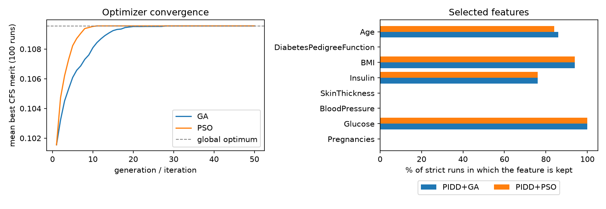

# PMSGD without SMOTE: GA vs PSO feature selection on the Pima diabetes data

Re-implementation of Azad et al., *Prediction model using SMOTE, genetic algorithm and decision tree (PMSGD) for classification of diabetes mellitus*, Multimedia Systems, 2021, run on the Pima Indians Diabetes Database (PIDD) **without SMOTE**. The notebook compares three variants and checks them against the paper's published numbers:

| Variant | Feature selection | In the paper? |
|---|---|---|
| PIDD | none, all 8 features | yes |
| PIDD+GA | CFS merit searched by a genetic algorithm | yes |
| PIDD+PSO | CFS merit searched by binary particle swarm optimization | no (future work) |

Everything is written from scratch except the data split, discretiser and metrics (scikit-learn), including a C4.5 decision tree, because scikit-learn has no gain-ratio tree.



## Repository layout

```
pmsgd_pidd_ga_pso.ipynb   the whole experiment (run this)
data/diabetes.csv         PIDD: 768 patients (268 diabetic, 500 not), 8 features + Outcome
azad2021.pdf              the paper
results/                  created on the first run (see "Outputs")
laporan_gambar/           figures used in the report
Laporan_Akhir.*           final report (Indonesian)
```

## Setup

Python 3.9+ and:

```bash
pip install numpy pandas scipy scikit-learn matplotlib jupyter
```

## Run

From this folder (the notebook reads `data/diabetes.csv` and writes `results/` relative to it):

```bash
jupyter notebook pmsgd_pidd_ga_pso.ipynb
```

Choose **Run All**. Or headless:

```bash
jupyter nbconvert --to notebook --execute --inplace pmsgd_pidd_ga_pso.ipynb
```

The full experiment takes a few seconds to about a minute, depending on the machine. The settings (splits, repeats, GA and PSO parameters) are in cell 2.

## What each section does

| Section | Functions | Purpose |
|---|---|---|
| 0. Imports and configuration | | Paths, feature list, paper parameters, paper results used for the comparison |
| 1. Pre-processing | `fit_preprocess`, `apply_preprocess` | A 0 in Glucose, BloodPressure, SkinThickness, Insulin or BMI means "missing" and is replaced by the column median; outliers are clipped to the Tukey fences. Values are learned once and re-applied to test data |
| 2. Dimensionality reduction | `symmetrical_uncertainty`, `cfs_merit`, `ga_select`, `pso_select`, `exhaustive_best` | CFS merit `m·r_cf / √(m + m(m−1)·r_ff)` is the fitness. GA: roulette selection, one-point crossover (pc 0.6), bit-flip mutation (pm 0.03), population 20, 50 generations, elitism. Binary PSO: 20 particles, 50 iterations, w 0.7, c1 = c2 = 1.5, vmax 4, sigmoid sampling. Brute force over all 255 subsets gives the true optimum |
| 3. Classifier | class `C45` | Gain ratio, MDL penalty, pessimistic-error pruning (CF 0.25), at least 2 instances per leaf |
| 4. Evaluation | `evaluate` | CA, CE, precision, sensitivity, F-measure, AUROC, confusion matrix (diabetic = positive) |
| 5. Protocols | `paper_split`, `strict_split`, `run_experiment` | `paper`: pre-process and select features on all data, then split (as the paper does). `strict`: split first, fit everything on the training part only. 3 variants × 5 splits (60-40 … 80-20) × 10 repeats × 2 protocols |
| 6. Reporting | `report`, `convergence_study` | Tables, paired tests, optimizer convergence over 100 seeds, paper-vs-experiment comparison |
| 7. Self-check | `self_check` | Fails loudly if the tree, pre-processing or optimizers are broken |
| 8–10. Run and read | | Executes the experiment, prints the results, short interpretation |

GA and PSO share the same fitness, budget (20 × 50 = 1,000 evaluations), tree, splits and seeds, so any difference between them comes from the optimizer alone.

## Outputs

Written to `results/`:

* `pidd_ga_pso_all_runs.csv`: one row per run and metric. Load the `features` column as text, or pandas drops leading zeros.
* Summary tables and figures from the reporting section.

## Main results

Mean over 50 runs (5 splits × 10 repeats), accuracy in %:

| Protocol | PIDD | PIDD+GA | PIDD+PSO |
|---|---|---|---|
| strict | 73.60 | 73.87 | 73.82 |
| paper | 73.93 | 75.09 | 75.09 |

Mean of the best 5 runs per split, the paper's reporting rule:

| Variant | Paper | Ours, strict |
|---|---|---|
| PIDD | 75.80 | 75.52 |
| PIDD+GA | 76.30 | 75.76 |

* The paper's PIDD and PIDD+GA results reproduce within 0.3 to 0.5 points under the leak-free `strict` protocol.
* Realistic accuracy is about 74%. The paper's 79.55% is a best-of-10 figure.
* The `paper` protocol is optimistic: features, medians and outlier fences are chosen using the test patients too.
* GA and PSO both reach the brute-force optimum (Glucose, Insulin, BMI, Age on the whole dataset) and are not significantly different in accuracy (p = 0.32). PSO gets there faster: median 5 iterations against 8.
* Feature selection mainly shrinks the tree (17.8 to about 9.7 leaves) and raises AUROC by about 0.02.

## Limitations

* Python, not Weka, so exact numbers cannot match; this C4.5 omits subtree raising.
* The outlier method, imputation and the 10-bin CFS discretisation are my choices; the paper does not specify them.
* PSO parameters were not tuned. With 8 features (255 subsets) the search is easy, which is why GA and PSO tie.
* The paper's per-run values are not available; the comparison uses its published best-run tables (6–10) and Table 11.

## Reference

M. Azad et al., "Prediction model using SMOTE, genetic algorithm and decision tree (PMSGD) for classification of diabetes mellitus," *Multimedia Systems*, 2021.
